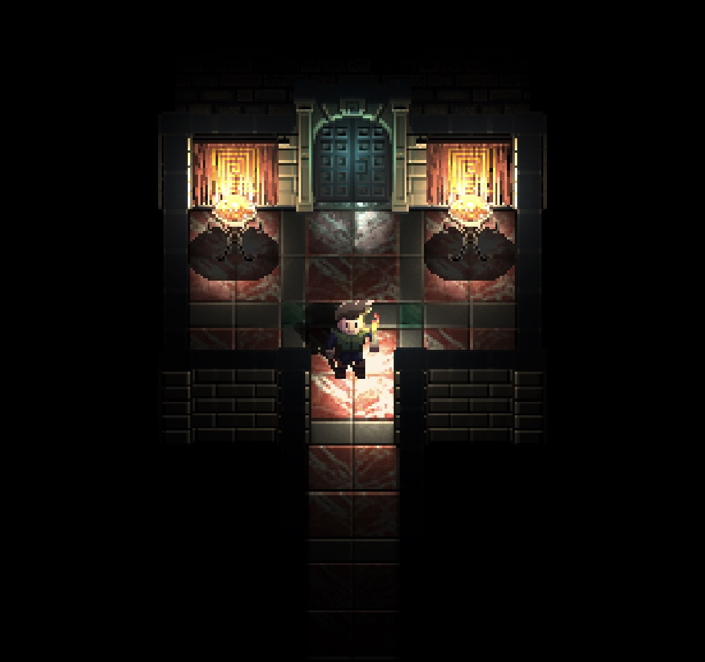
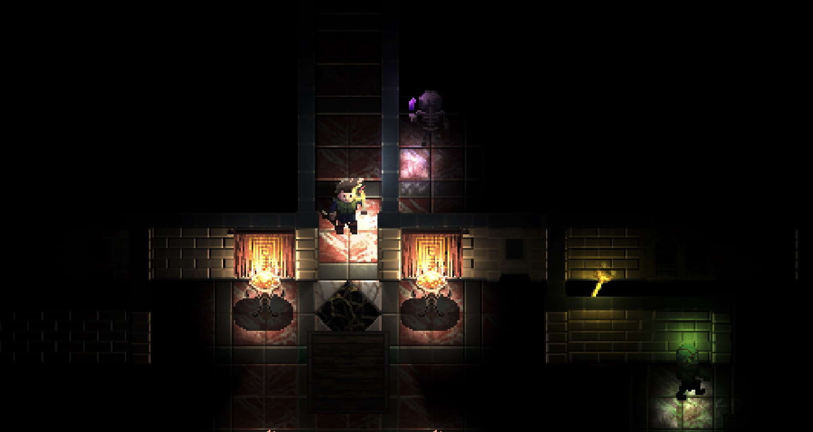
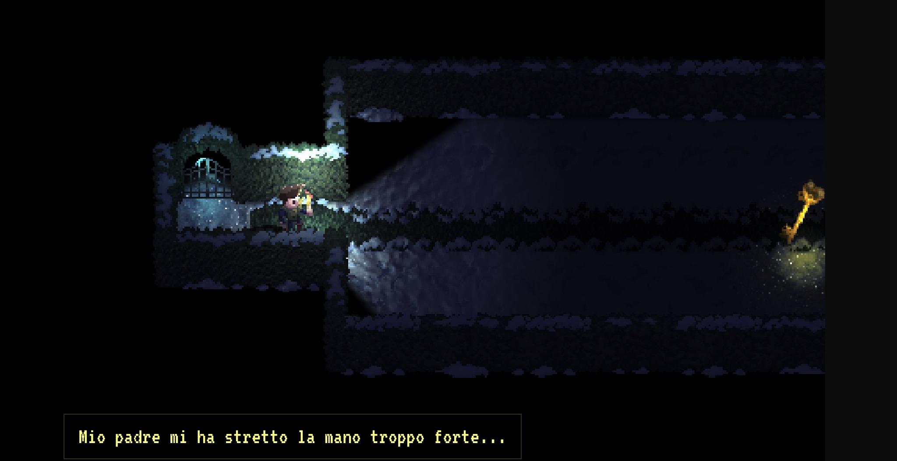

# Mark in DeDark

**Uno stealth dall'alto, al buio, con una sola candela in mano.**

### [▶ Gioca ora sul web](https://imaginesoftware.it/mark-play/)

Gratis, nel browser. Nessuna installazione, nessuna pubblicità, nessun tracciamento.



_Mio padre mi ha stretto la mano troppo forte... come al solito._ Poi mi ha lasciato lì, davanti al portone di un castello buio, con in mano una sola candela: è la prova di coraggio che farà di Mark un adulto.

Ti muovi nell'ombra, eviti i nemici che pattugliano le sale, trovi la chiave e raggiungi l'uscita prima di essere scoperto. Le candele sparse nei livelli si piazzano a terra come esca, per attirare, distrarre o bloccare i nemici: sono poche apposta, e ogni livello parte a inventario vuoto. La storia completa, dal progetto multiplayer su UDP dell'università a oggi, è sulla [pagina del progetto](https://imaginesoftware.it/open-source-projects/mark-in-dedark).

## Il bestiario

Ogni nemico ha una sua personalità e un suo punto debole.

- **Zombie**: pattuglia lento e meccanico, senza mai deviare. Basta studiarne il ritmo.
- **Scheletro**: ti insegue se ti vede in linea retta. Esci dalla sua linea di vista e se ne andrà.
- **Taurus**: carica in linea retta e sfonda i muri rompibili. Puoi indirizzarlo contro un muro, una trappola o gli altri nemici.
- **Ghost**: attraversa i muri e attacca solo se ti muovi. Resta immobile e ti passerà attraverso.
- **Bubu**: vuole spegnerti le candele, ma ha paura dei bracieri grossi.
- **Goblin**: sa sempre dove sei, e diventa più veloce ogni volta che usi una candela.



## Dietro le quinte: un 2D che finge il 3D

L'immagine nasce da tre layer: il pavimento, una _lightmap_ di sole ombre, gli oggetti (muri, pilastri, personaggi). Ogni layer è illuminato con il **normal mapping**, così sprite piatti sembrano scolpiti dalla luce. Le **ombre morbide** sono proiettate in tempo reale da ogni sorgente, eredi della libreria [Penumbra](https://github.com/discosultan/penumbra), riscritta per TypeScript e PixiJS. Ogni entità emette la propria luce colorata e animata.

Il funzionamento completo è documentato in [`docs/rendering/RENDERING_PIPELINE_PIXIJS.md`](docs/rendering/RENDERING_PIPELINE_PIXIJS.md).



## Editor dei livelli

I livelli sono file di testo `.mark` in [`Web/public/assets/levels`](Web/public/assets/levels). Il gioco include un editor visuale per crearli e modificarli nel browser, su `/mark-play/level-editor`, con le linee guida di design su `/mark-play/level-editor/guidelines` (generate da [`docs/LEVEL_DESIGN_GUIDELINES.md`](docs/LEVEL_DESIGN_GUIDELINES.md)).

## Tecnologie

La versione web, quella pubblicata, è in [`Web/`](Web): [TypeScript](https://www.typescriptlang.org), [PixiJS 8](https://pixijs.com) per la grafica, [Howler.js](https://howlerjs.com) per l'audio, [Navigo](https://github.com/krasimir/navigo) per le pagine, [Vite](https://vite.dev) per la build, [Playwright](https://playwright.dev) per i test di debug.

La cartella [`Csharp/`](Csharp) contiene la versione originale in C# con [MonoGame](https://github.com/MonoGame); come compilarla su macOS è spiegato nel suo [README](Csharp/README.md).

## Avviarlo in locale

Serve [Node.js](https://nodejs.org) 20.19 o successivo (lo richiede Vite 7).

```bash
cd Web
npm install
npm run dev
```

Il gioco risponde su `http://localhost:5173/mark-play/`: il percorso coincide con quello di pubblicazione sul sito. `npm run dev` e `npm run build` rigenerano prima i manifest dei livelli e degli spritesheet; `npm run build` produce la versione statica in `Web/dist`.

## Crediti

- Codice: Francesco Bonizzi
- Direzione artistica e grafica, disegnata a mano: [Marco Oppici](https://www.linkedin.com/in/marco-oppici-b43471187)

## Licenza

Codice, grafica e audio sono rilasciati sotto [licenza MIT](LICENSE). Penumbra e i font di terze parti restano sotto le loro licenze: l'elenco è in [`THIRD-PARTY-NOTICES.md`](THIRD-PARTY-NOTICES.md).

---

Se ti è piaciuto, puoi [offrirmi un espresso](https://www.paypal.com/cgi-bin/webscr?cmd=_donations&business=DTT7P8N3TV7N6&currency_code=EUR&source=url) ☕
